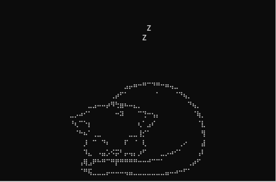
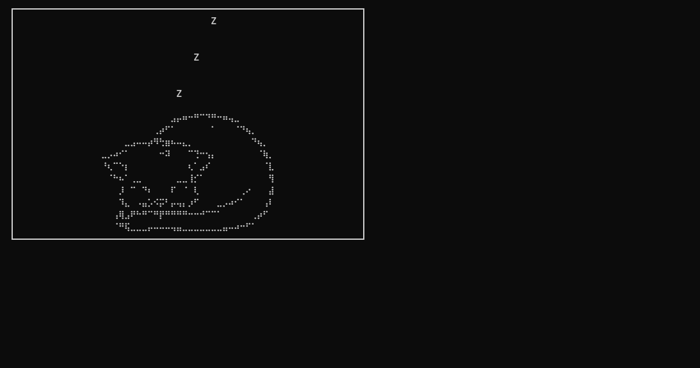

   

#  Sleeping cat 

  
- ### the history of the creation of this program
  - This program was created to decorate your desktop and make things comfortable and cozy for you :)
  - Oh, I almost forgot—about the program: I wrote it practically on my own in a single evening.
- ### additionally
  -  This program is licensed under the GPL, so at any time you can take the source code and modify your animation—perhaps of sleeping animals, perhaps awake ones, or maybe even things that aren't animals at all.

- ### How do I install it?
- ##### Download Go
  

<b>Installing Go for Windows:</b>Download the installer from https://go.dev/dl/ (go1.22.x.windows-amd64.msi), run it, and follow the instructions.

<b>Installing Go for Linux:</b>

 ##### Debian(Mint,Ubuntu)
      sudo apt install golang-go

 #####  Fedora
      sudo dnf install golang

#####  Arch
      sudo pacman -S go

<b>Installing Go for macOS:</b>

     brew install go

- ### How do I launch it?
        For windows
   Download the archive and run the `cat.exe` file.
              
        For Linux
    Right-click inside the folder, select "Open in Terminal," and type `go run main.go`.

        For macOS  
    Right-click to open a new terminal, or simply open a terminal, navigate to the project folder using `cd`, and run `go run main.go`.

- ### Screenshots
  

